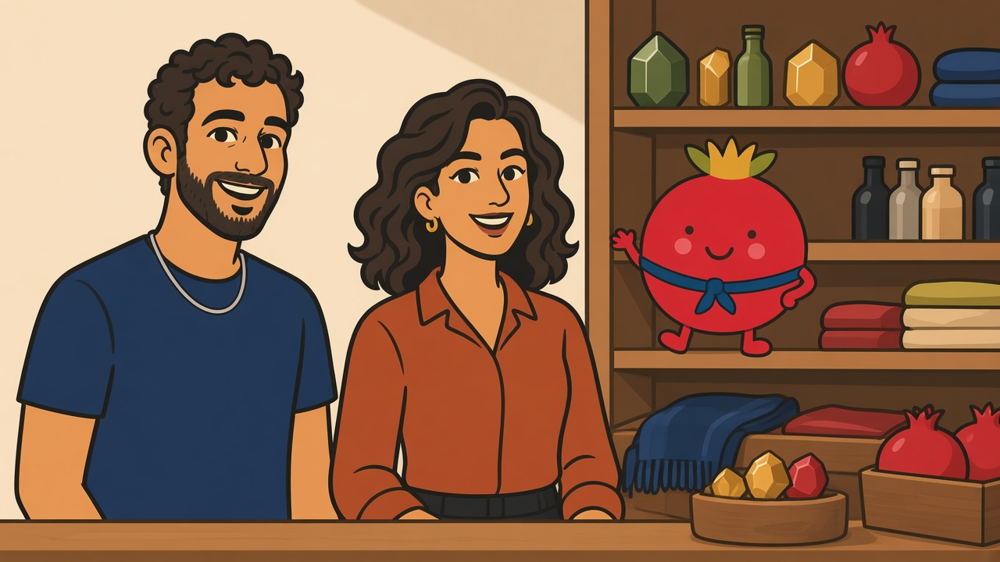
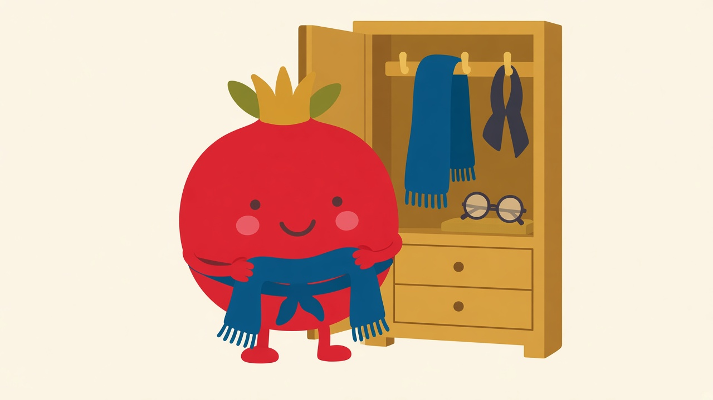
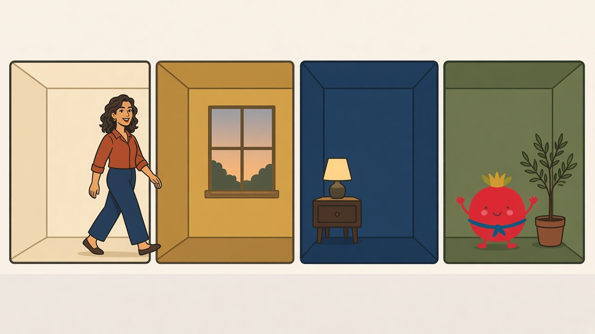
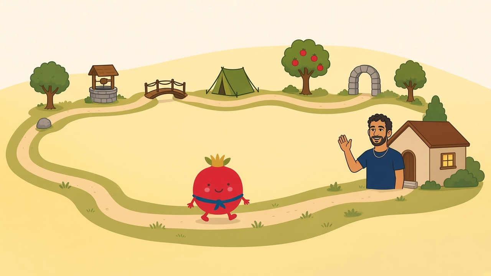
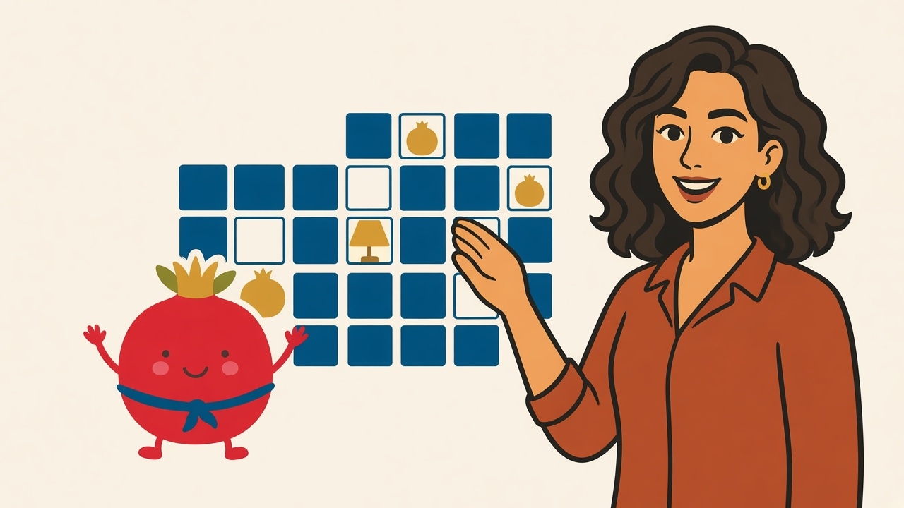

# Pictures of the T1 to T7 features

These pictures are for this documentation only. They are not part of the first install, and they are not used by the app.

They show the seven features that went live on Friday, 13 November 2026 (America/Toronto), in versions `b17caa626bb9` (T1 to T3) and `40f95a11457f` (T4 to T7).

The people in the pictures are Ari and Noa. The small round pomegranate is Rimon.

## T1. A bigger shop

## T2. Rimon's closet

## T3. Looks you unlock

## T4. Seven-day trip map

## T5. Mysteries on Awards

## T6. Kislev season card

## T7. Days you opened Aleph

