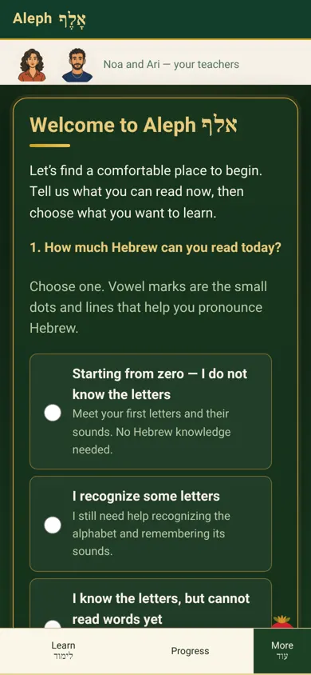
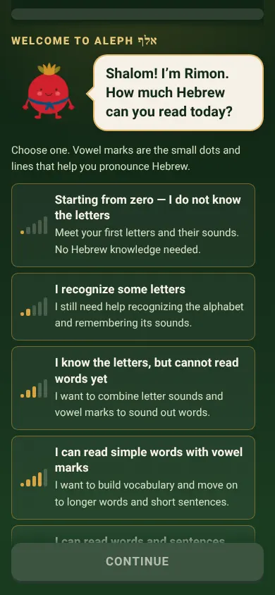
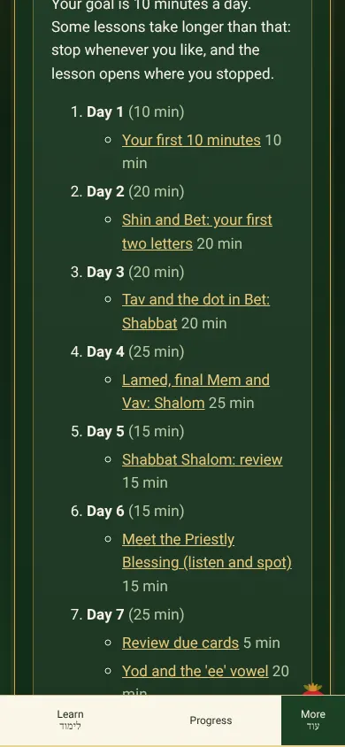
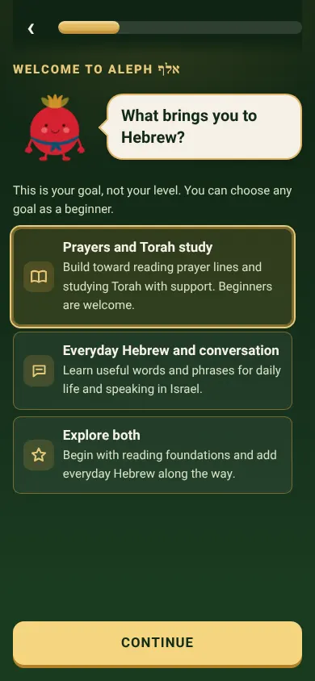
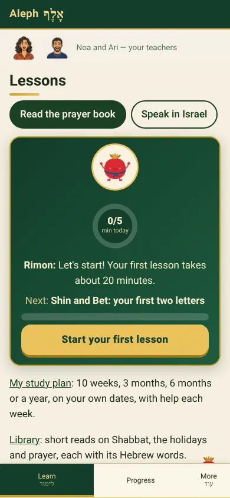
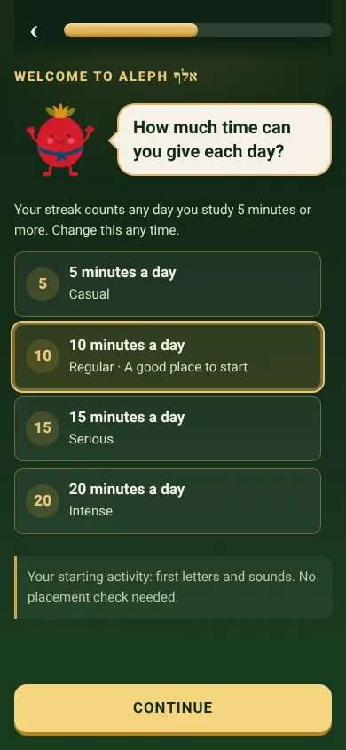
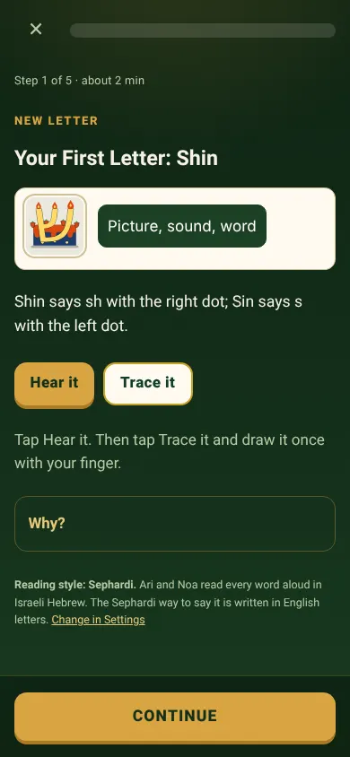
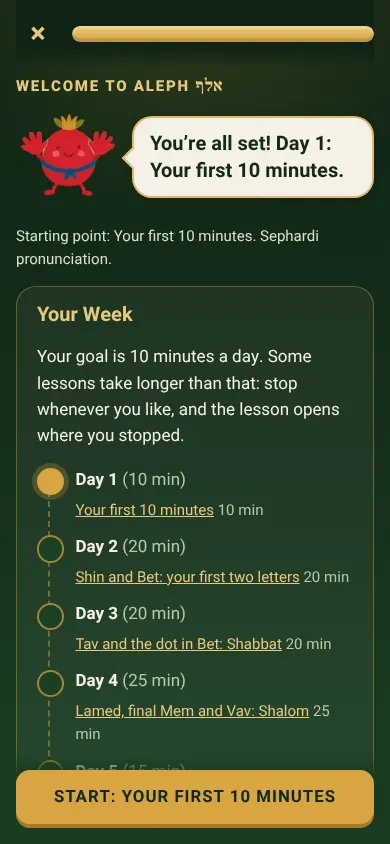
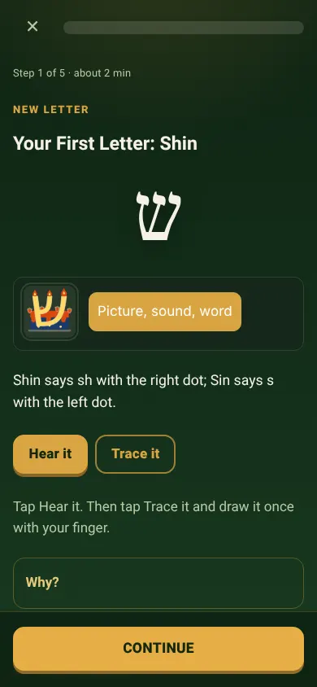
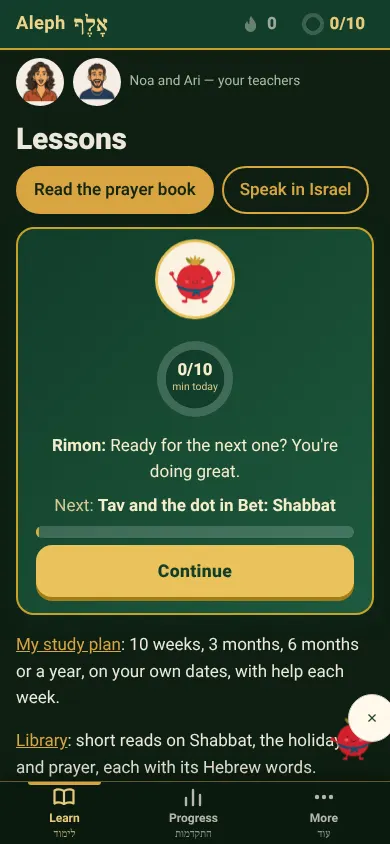

# First Minute, Look and Consistency vs Duolingo (2026-11-10)

Scope: what a brand-new learner sees from opening the app to finishing the first lesson, plus the main screens after it (Home, Learn, Progress, Brain Lab), at phone size (390 x 844). Checked by scripted walks in headless Chrome with screenshots, and by the unit tests. Not checked: a real phone, a screen reader, a learner.

## Gaps found, ranked by first-minute impact

| # | Gap (before) | Duolingo does | Fixed in this branch |
|---|---|---|---|
| 1 | Setup was one long form: two questions, eight option cards, no mascot, tab bar and teachers band showing | One question per screen, the mascot asks it, progress bar on top, one big Continue pinned at the bottom, no tabs | Yes: three pages (reading level, goal, daily goal), Rimon asks each in a speech bubble, progress bar, Back, pinned Continue, chrome hidden |
| 2 | Tapping an answer (setup and the lesson player) scrolled the page down: the "keep focus above the tab bar" code measured the hidden tab bar | Taps never move the page | Yes: the check now skips a hidden bar (src/app.js) |
| 3 | Each setup step opened half-way down; the plan opened below its own Start button | Each screen opens at its top | Yes |
| 4 | No daily goal choice at first run (it sat behind "Change goal or minutes a day") | Asks 5, 10, 15 or 20 minutes as a commitment | Yes: Casual, Regular (preselected, the plan default), Serious, Intense; saved as the plan minutes and the Home goal |
| 5 | Time in "Your First 10 Minutes" never counted toward the streak (route missing from the counted list) | The first lesson starts the streak | Yes: /firstday, /firstwin and /placement count, like /learn (rule unchanged: a day counts at 5 minutes) |
| 6 | No streak or goal in sight outside the Learn page | Streak flame and goal in the top bar on every main screen | Yes: header chips, flame with day count (lights when today counts) and today's minutes against the daily goal |
| 7 | First lesson finish had a check-mark medal and "Five minutes of study today starts your streak." | The mascot celebrates, then a streak screen | Yes: Rimon high-fives; a flame card fills toward 5 minutes and lights live (with the streak sound) if the day starts to count while the screen is open |
| 8 | The first letter (Shin) was never shown large on its own screen: the memory card replaced it with a thumbnail when it loaded | The new character is the hero of the screen | Yes: the letter stays large above its picture card |
| 9 | Look split by device setting: cream pages with green cards in light mode, green in dark; teachers band always cream | One look | Yes: dark green and gold is the default theme (owner's order 2026-11-08); the band takes the page colours; Light and Match device stay in Settings |
| 10 | Tab bar: text only, uneven widths, More clipped at 390 px, Progress had no Hebrew label | Icon tabs, equal widths | Yes: icons, equal widths, gold marker on the current tab, התקדמות under Progress |
| 11 | Three button styles (flat pill, gold pill, chunky lesson button) | One chunky pressable button | Yes: one style from the tokens (14 px corners, 4 px lip, presses down) |
| 12 | Learn goal ring said 0/5 while setup said 10 minutes a day | One number | Yes: the ring uses the daily goal |
| 13 | Lesson list read as a list | A winding path with the current stop marked | Partly: the list winds on phones too, a dotted trail joins the stops, the current stop has a Start tag and rises gently; still cards, not bare circles |
| 14 | Rimon sheets were about 1 MB each, loaded on every page | Light assets | Yes: WebP copies at about 100 KB each (originals kept) |

Not fixed here, for later rounds: the opening prayer appears before the welcome on the very first visit (kept: the owner asked for it on open); no XP or gems (by design: badges instead); the lesson path is still cards, not circles with a pop-over; no leagues or friends; Rimon has 12 moves, not 200.

## Before and after

| Before | After |
|---|---|
|  |  |
|  |  |
|  |  |
|  |  |
| |  |
| |  |

## Files

- `assets/css/tokens.css` (new): spacing, type, corners, lip, shadows, motion, brand colours.
- `assets/css/polish.css` (new, loaded last): buttons, headings, header chips, tab icons, setup screens, Rimon bubble, path, finish flame, first letter.
- `src/onboarding/firstrun.view.js`: the one-question-per-screen setup (same store keys, ids and answers as before).
- `src/shell/statbar.js` (new), `src/shell/rimon-inline.js` (new), `assets/img/rimon/web/*.webp` (new).
- `src/firstday/firstday.view.js`: Rimon, the flame, the large first letter.
- `src/morning/engage.js`: first lesson counts toward the day. `src/app.js`: hidden tab bar no longer scrolls the page.
- `src/shell/settings.js`: default theme dark green and gold. `src/shell/companions.js`, `src/shell/nav.js`, `src/shell/nav-model.js`, `src/shell/i18n.js`, `src/curriculum/learn.view.js`.
- `tools/build-precache.mjs`, `src/shell/offline.js`: three preview-only views (word builder, Sound like a local, Common phrases) load on first open, keeping the first install under 3.95 MiB.
- Tests: `tests/firstminute.test.js` (new, 10), `tests/onboarding.test.js` (+4, one count updated from 2 to 3 questions), `tests/morning.test.js`, `tests/integration.test.js` (default theme), `tests/cognitive.test.js` (five new animations added to the motion inventory with their review note). Unit tier: 3,334 tests, 3,324 pass, 0 fail, 10 skipped.

## For native review

- התקדמות (Progress) as the tab's Hebrew label.

## Round 2 (2026-11-10, about 2 AM)

- Every lesson summary now ends like the first lesson: Rimon plays his high five in the page and the streak flame card fills toward 5 minutes and lights live (src/shell/flame.js, shared).
- A one-time "Today counts" toast appears wherever the learner is when the day lights.
- Merged `overnight/launch-ready-2026-11-10` into this branch: its one-tap quick start sits under Continue on the first question; its text flame on the lesson summary is folded into the live flame card; three more preview views load on first open to keep the first install under budget.
- Locked path stops and the cheer line are readable on dark green.
- Branch review round 1: [BRANCH-REVIEW-R1-2026-11-10.md](BRANCH-REVIEW-R1-2026-11-10.md).

## Round 3 (2026-11-10, about 2 AM): self-review against GitHub

Checked against `main` at b574744 (merged in; no conflicts) and `overnight/launch-ready-2026-11-10` at c9e9e17 (already merged). Scripted phone-size walk repeated after the changes.

Fixed this round:
1. The lesson list still read as a stack of cards. Now only the next lesson is a card; finished lessons are gold stops with a check, the next stop has a star and the Start tag, locked stops show a lock and no dead Start button (the disabled button stays in the page for screen readers).
2. If a Rimon sheet could not load, the page showed an empty box. Rimon now falls back to his single picture, still.
3. On the first setup question the two pinned buttons (Continue and the quick start) covered the last answer. The page now leaves room for both.
4. The branch was three commits behind `main`; merged.

Still open, ranked:
1. No real phone and no screen reader has been used on any of this; only headless Chrome at 390 x 844 and unit tests.
2. Three ways of showing Rimon (the animated sheets here, `rimon-show.js` stills on launch-ready, the trigger map on `lane-rimon-mascot`); the stills are opaque cream squares. One map and transparent stills are needed before Rimon can appear on more screens.
3. The opening prayer is the very first screen on a first visit, before Rimon and setup (the owner asked for Mah Tovu on the first visit; kept, flagged).
4. Fixed in round 3: a tap anywhere on an open stop opens its lesson (keyboard and screen readers keep the Start or Review button). Still not a pop-over card like Duolingo's.
5. The first lesson can finish before 5 engaged minutes, so day 1 often does not light on the first visit (rule kept; the flame says how many minutes are left).
6. Two buttons on the first setup screen (Continue and "New to Hebrew? Start now") split attention; one may be enough.
7. Progress and Brain Lab use the tokens but were not reworked screen by screen.
8. No browser-tier test drives the new setup flow; it is covered by fake-DOM unit tests and scripted walks only.

## Round 4 (2026-11-10, about 3 AM): weaknesses found and the plan fixed

New checks this round: the repo's accessibility gate (`node tools/a11y/gate.mjs`: keyboard walk, axe on 15 routes in light and dark, 200% zoom reflow), a keyboard-only run of setup, the light theme, and a new browser test (`tests/firstminute.browser.test.js`: setup by keyboard, no page jump, chips and path after setup, axe A/AA on all six screens).

Weaknesses found, and what was done:

| # | Weakness | Found by | Fix |
|---|---|---|---|
| 1 | Header chips: the spoken name did not contain the number shown ("0" was read as "No streak yet"), on every page | axe label-content-name-mismatch | Fixed: names start with the visible text ("0-day streak...", "0/10 minutes today") |
| 2 | At 200% zoom the header was 260 px wide on a 195 px screen; on setup Rimon and his bubble did not fit | gate reflow check | Fixed: header wraps; below 300 px Rimon stacks above a smaller bubble |
| 3 | First lesson: the memory card's main button was white on gold in the dark theme | axe color-contrast | Fixed: it uses the accent text colour |
| 4 | The keyboard walk still expected the old one-page setup | gate keyboard walk | Fixed: the walk now answers the three questions one screen at a time |
| 5 | Two big buttons on the first question | review | Fixed: the quick start is a quiet text link under Continue |
| 6 | The Learn card's Rimon was a still picture while every other screen had the animated Rimon | review | Fixed: he waves (first lesson) or points to the next one |
| 7 | No browser test drove the new setup | review | Fixed: tests/firstminute.browser.test.js |

After the fixes the gate passes: keyboard walk with no failures, axe and 200% zoom on 15 routes in light and dark with 0 findings, colour pairs as in the baseline. Not this lane's code, found on the way: `/calendar` has 12 axe label-in-name findings ("Download file" buttons whose spoken name omits those words, and day links), which `tests/a11y.fixes.test.js` reports once axe-core is installed in `tools/a11y`.

The plan from here (each item says what done looks like):

1. **Real phone and screen reader (owner or tester, about 30 minutes).** Done when: setup, the first lesson and Learn are walked once on an iPhone with VoiceOver and once on Android with TalkBack, and anything found is fixed. Nothing else on this list replaces it.
2. **One Rimon (Rimon lanes, then this lane).** Done when: the stills have transparent backgrounds, one situation map is shared, and `rimonInline` uses a still where one exists and the animated sheet otherwise. Until then this lane keeps the animated sheets, which are on-model.
3. **Opening prayer before setup on a first visit (owner decision).** Kept as ordered. Option if wanted: show the welcome first and the prayer after setup on day one only.
4. **First-visit streak.** Kept: 5 engaged minutes lights a day. The flame says how many minutes are left; the next lesson button is under it.
5. **Path stop card on tap.** A tap now opens the lesson. A small pop-over card (title, minutes, Start) like Duolingo's is the next step if testers miss it.
6. **Progress and Brain Lab screen by screen.** They use the tokens; a pass on each with the same eye as setup is next.
7. **Hero images.** Orders written (docs/images/orders/HERO-HOME-PRAYER-2026-11-10.md); swap-in code is written there for when the files land.

## Round 5 (2026-11-10, about 4 AM): review of 587b503 (review round 3 of 5) and the next build

**Review of the branch at 587b503 (score 84/100).** What it got right: one question per screen with Rimon, the lesson path as stops, every lesson ending with Rimon and the live flame, the gold prayer lettering as real text, hero orders that keep lettering out of generated images. What was wrong at that commit, found by the accessibility gate and fixed in e8de60b: header chips spoken without their number (every page), the header 260 px wide at 200% zoom, the memory-card button below contrast on dark green, the keyboard walk still on the old setup. Still wrong at that commit and fixed now:

| # | Weakness | Fix (this round) |
|---|---|---|
| 1 | Progress had its own "daily goal" counted in review cards, next to the minutes goal shown in setup, Home, Learn and the header | Progress opens with the header's two numbers, large (streak and minutes against the setup goal); its card goal is now called the review goal |
| 2 | A tapped locked stop did nothing | It now says which lesson opens it ("Opens after you finish ...") |
| 3 | A new badge was saved silently (only the corner Rimon stretched) | A toast names the badge with a link to Awards, the moment it is saved |

Checks this round: unit tier 3,368 tests, 1 failure (the `/calendar` axe finding outside this lane, listed in round 4); `tests/firstminute.browser.test.js` passes; the accessibility gate passes with no regression (keyboard, axe and zoom on 15 routes including Progress, contrast).

**Plan to 95 to 100** (what done looks like):
1. Real iPhone with VoiceOver and Android with TalkBack through setup, the first lesson, Learn and Progress (a person, about 30 minutes). Biggest remaining risk; no amount of headless checking replaces it.
2. One Rimon: transparent stills plus one situation map; `rimonInline` uses a still where one exists.
3. Hero images generated from the orders and swapped in; gold lettering stills checked by a Hebrew reader.
4. The opening prayer after setup on day one (owner decision; kept as ordered until then).
5. The `/calendar` label-in-name findings fixed by the calendar's owner.

## Round 6 (2026-11-10, about 5 AM): review of 10cc015 (review round 4 of 5) and the next build

**Review of the branch at 10cc015 (score 91/100).** CI passed on that commit. Screens checked headless at phone size after the opening prayer (Home, Learn, Progress, the first lesson). What it got right: one goal number everywhere (header, Learn ring, Progress), a locked stop that says why, badge toasts. Still wrong at that commit and fixed now:

| # | Weakness | Fix (this round) |
|---|---|---|
| 1 | Two Rimons at once: on Learn the corner Rimon stood under the lesson card's own Rimon, and his speech bubble covered the study plan text | One Rimon per screen: when a page draws its own Rimon (Learn card, a lesson summary, a say-bubble) the corner one steps aside. This is not saved as a dismissal; he is back on the next page that has no Rimon of its own |
| 2 | On phones the corner Rimon ducks behind the bottom bar after two seconds, but his bubble stayed and floated over Progress text | The bubble ducks with him |
| 3 | `/calendar`: 12 axe label-in-name findings (the day cells and the download buttons), the one unit-tier failure since round 4 | Day cells: the visible numbers are hidden from screen readers and the full spoken name rides in a visually hidden span, so no label can mismatch. Download buttons: the name starts with the visible "Download file". Outside this lane but small; the calendar tests were updated to read the spoken name |

Checks this round: `tests/firstminute.browser.test.js` (now 2 tests, one for the Rimon rules) and `tests/a11y.fixes.test.js` pass with the `/calendar` scan included; the calendar unit tests pass; the accessibility gate passes (keyboard 152 ok, 15 routes with 0 findings, contrast with its one documented exception).

**Plan to 95 to 100** (unchanged at the top, because only a person can do it):
1. Real iPhone with VoiceOver and Android with TalkBack through setup, the first lesson, Learn and Progress.
2. Rimon stills with transparent backgrounds and one situation map; `rimonInline` uses a still where one exists.
3. Hero images generated from the orders and swapped in; gold lettering stills checked by a Hebrew reader.
4. The opening prayer after setup on day one (owner decision). It also opens before a shared deep link such as `#/ask?q=...`; worth deciding together.
5. A tap-to-open card on path stops if testers miss it.

## Round 7 (2026-11-10, about 6 AM): review of a83e7132d (review round 5 of 5) and the next build

**Review of the branch at a83e7132d (score 93/100).** CI passed on that commit. Screens checked headless at phone size: Learn (path), Brain Lab, Games, Progress. What it got right: one Rimon on Learn, the bubble ducking with him, the calendar labels. Still wrong at that commit and fixed now:

| # | Weakness | Fix (this round) |
|---|---|---|
| 1 | "Test out" on the first path stop was a full button the same size as Start, so a beginner's first tap could skip the first lesson | It is a quiet underlined text link under Start (still 44 px tall, same wording and screen-reader label) |
| 2 | No "in a row" moment inside lessons, the most recognisable bit of Duolingo feedback | The answer band says "3 in a row!" at 3, 5, 10 and every 5 after, turns gold, and Rimon celebrates. A wrong answer or a new page starts the run again. The band stays visual only; each screen still writes its own verdict for screen readers |
| 3 | Games showed two Rimons: a still picture on a cream square (the opaque-background still) and the corner Rimon | Games uses the same animated Rimon as setup, Learn and the lesson summary, and the corner Rimon steps aside there |

Checks this round: the new unit test for the run of right answers and the browser test for one Rimon on Learn and Games pass; the games tests pass.

**What is left for 95 to 100.** None of it can be finished from this side:
1. Real iPhone with VoiceOver and Android with TalkBack through setup, the first lesson, Learn and Progress.
2. Rimon stills with transparent backgrounds and one situation map (the stills lane).
3. Hero images generated from the orders; gold lettering stills checked by a Hebrew reader.
4. Owner decision: the opening prayer before setup on day one, and before a shared deep link such as `#/ask?q=...`.

## Final polish pass (2026-11-10, about 6 AM)

Headless sweep at phone size of Home, Learn, Progress, Brain Lab, Games, Settings and Read: no script errors, no sideways scrolling. One fix: Brain Lab's "Your Skills" heading sat against the workout card; it now has the standard 1.5 rem gap.

## Round 8 (2026-11-10, about 7 AM): a lighter first screen

Measured with headless Chromium on the local server, cold load of the welcome screen, no service worker (uncompressed bytes; GitHub Pages compresses JSON, so the real transfer is smaller):

| | Before | After |
|---|---|---|
| Bytes before the first question can be answered | 2,301 KB, 104 requests | 1,642 KB, 102 requests |

| # | What was heavy | Fix |
|---|---|---|
| 1 | Setup downloaded the whole lesson file (462 KB) to build the plan | Setup reads `data/curriculum/lessons.index.json` (17 KB: id, track, level, title, minutes, prerequisites), written by `tools/curriculum/lessons-index.mjs`. If the index cannot be read it falls back to the full file. A unit test fails if the index is stale, and checks that every starting level and goal gives the same plan from the index as from the full file |
| 2 | All three setup pages loaded their own Rimon move sheet (about 100 KB each) up front | Each page's Rimon starts on the wave sheet the first page already uses and plays its own move when its page opens |

Not measured: a real phone on a slow network.

## Round 9 (2026-11-10, about 8 AM): the week strip

Progress showed the streak as a number and the week as sentences further down. Duolingo's most-looked-at streak view is the row of days. Progress now has a strip of the last seven days under its two numbers (`src/shell/weekstrip.js`, built from the same streak record as the header flame):
- a flame for each day studied;
- a candle for Shabbat, a festival or a declared rest day (never shown as a miss);
- a gold ring for today until it counts;
- a small dot for a day without study.

Each day has a spoken name ("Saturday: Shabbat, a rest day"); the marks are hidden from screen readers. In forced-colours mode the marks are drawn in the system text colour. Checked headless at phone size with a seeded record, and by a unit test of all four states.

## Score

Round 9: 95/100 (before this round: 95; the strip closes a visible Duolingo gap, the real-phone pass is still open). Round 8: 95/100 (before this round: 94; the first screen downloads about 660 KB less). Round 7: 94/100 (before this round: 93; the a83e7132d commit reviewed at 93). Round 6: 93/100 (before this round: 91; the 10cc015 commit reviewed at 91). Round 5: 91/100 (before this round: 89; the 587b503 commit reviewed at 84). Round 4: 89/100 (before this round: 86). Round 3: 86/100 (before this round: 82). Round 2: 82/100. Round 1: 72/100 for this round (first minute, look and consistency against Duolingo). What would raise it: the path as true round stops with a tap-to-open card; a lesson-complete screen for every lesson (not just the first) with Rimon and the flame; Rimon's move set used across Home, Progress and Brain Lab; a real-phone and screen-reader pass; streak-freeze and badge moments shown at the moment they happen.
